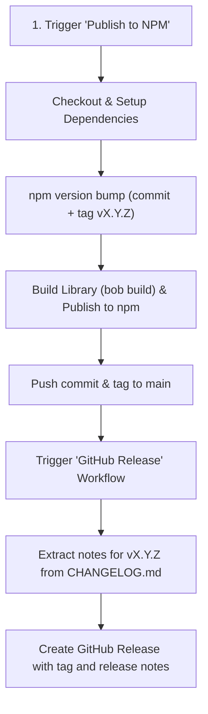

# SDK Release Guide & Discipline

This document outlines the official release process, versioning discipline, and checklists for releasing new versions of the **`react-native-tpstreams`** SDK to npm and GitHub.

---

## 1. Versioning Discipline (SemVer)

This project strictly adheres to [Semantic Versioning (SemVer)](https://semver.org/):

$$\text{MAJOR}.\text{MINOR}.\text{PATCH}$$

| Version Type | When to Use | Examples |
| :--- | :--- | :--- |
| **`patch`** | Backwards-compatible bug fixes, performance improvements, or minor native dependency patches | `1.1.27` $\rightarrow$ `1.1.28` |
| **`minor`** | Backwards-compatible new features, new props, new APIs, or notable SDK enhancements | `1.1.28` $\rightarrow$ `1.2.0` |
| **`major`** | Breaking API changes, removed deprecated features, or minimum React Native / OS version bumps | `1.2.0` $\rightarrow$ `2.0.0` |

---

## 2. Pre-Release Checklist

Before triggering a release, complete the following steps on `main`:

- [ ] **All PRs merged:** Ensure all target changes are merged into the `main` branch.
- [ ] **CI is Green:** Verify the latest commit on `main` passed the [CI workflow](https://github.com/testpress/react-native-tpstreams/actions/workflows/ci.yml) (lint, typecheck, tests, and example build).
- [ ] **Native SDK versions checked:** If native changes occurred, verify:
  - Android Player SDK version in `android/build.gradle`
  - iOS Player SDK version in `TPStreamsRNPlayerView.podspec`
- [ ] **Changelog updated:** Ensure [CHANGELOG.md](../CHANGELOG.md) has an entry for the version you are about to release.

---

## 3. Changelog Rules

The release workflow automatically extracts release notes from [CHANGELOG.md](../CHANGELOG.md) to generate the GitHub Release. For this to work seamlessly, follow the [Keep a Changelog](https://keepachangelog.com/en/1.0.0/) standard:

### Format:
```markdown
## [2.0.0] - 2026-10-12

### Breaking Changes
- `oldPropName` has been removed. Use `newPropName` instead.
- Minimum supported React Native version raised to 0.76+.

### Added
- New features or new props added.

### Changed
- Changes in existing functionality or native SDK version updates.

### Fixed
- Bug fixes.
```

### Key Rules:
1. **Header Format:** Use `## [X.Y.Z] - YYYY-MM-DD` (e.g., `## [1.1.28] - 2026-10-08`).
2. **Standard Subsections:** Group changes under the appropriate heading:
   * **`### Breaking Changes`** (Always list first if present; requires a **`major`** version bump and migration instructions).
   * **`### Added`** (New features, props, callbacks).
   * **`### Changed`** (Modifications to existing behaviors or dependency bumps).
   * **`### Deprecated`** (Upcoming removals that still function with warnings).
   * **`### Removed`** (Features removed in this version).
   * **`### Fixed`** (Bug fixes).
   * **`### Security`** (Vulnerability fixes).
3. **Reference Links:** Keep the compare links updated at the very bottom of `CHANGELOG.md`:
   ```markdown
   [1.1.28]: https://github.com/testpress/react-native-tpstreams/compare/v1.1.27...v1.1.28
   ```

---

## 4. How to Trigger a Release

All releases are automated through GitHub Actions.

### Step 1: Open GitHub Actions
Navigate to the **Actions** tab in the repository:
👉 [Actions > Publish to NPM](https://github.com/testpress/react-native-tpstreams/actions/workflows/npm-publish.yml)

### Step 2: Run the Workflow
1. Click the **Run workflow** dropdown button.
2. Select branch: **`main`**.
3. Select `version_type`:
   * `patch` (default)
   * `minor`
   * `major`
4. Click **Run workflow**.

---

## 5. What Happens Automatically

The release process runs two coordinated workflows:



1. **Version Bump:** `npm version` increments `package.json`, creates a commit `chore(release): X.Y.Z`, and creates the git tag `vX.Y.Z`.
2. **Build & Publish:** Runs `yarn prepare` (`bob build`) to compile native and TS outputs to `lib/`, then publishes the package to public npm using `NPM_TOKEN`.
3. **Push to GitHub:** Pushes the version commit and git tag back to `origin/main`.
4. **Trigger GitHub Release:** Dispatches the [Release](https://github.com/testpress/react-native-tpstreams/actions/workflows/release.yml) workflow with the new tag.
5. **Release Notes Creation:** Parses `CHANGELOG.md` for that version's section and creates the official GitHub Release with those notes. (If no changelog entry is found, it falls back to GitHub auto-generated notes).

---

## 6. Post-Release Verification

After the workflow finishes:

1. **Verify npm package:** Check that the new version is live on npm:
   👉 [npmjs.com/package/react-native-tpstreams](https://www.npmjs.com/package/react-native-tpstreams)
2. **Verify GitHub Release:** Check that the release was created with the correct changelog notes and tag:
   👉 [GitHub Releases](https://github.com/testpress/react-native-tpstreams/releases)
3. **Verify Git History:** Pull the latest `main` branch locally to synchronize your local workspace:
   ```bash
   git checkout main
   git pull origin main --tags
   ```

---

## 7. Troubleshooting

| Issue | Cause | Solution |
| :--- | :--- | :--- |
| **Release workflow didn't extract notes** | Version header in `CHANGELOG.md` didn't match `## [X.Y.Z]` format | Edit the GitHub release manually on GitHub Releases page, and fix the format in `CHANGELOG.md`. |
| **npm publish failed: 403 Forbidden** | `NPM_TOKEN` secret is expired or lacks publish rights | Update the `NPM_TOKEN` secret in repository settings (`Settings > Secrets and variables > Actions`). |
| **Manual GitHub Release needed** | A tag was pushed manually without the workflow | Go to **Actions > GitHub Release**, click **Run workflow**, and pass the tag name (e.g. `v1.1.28`). |
